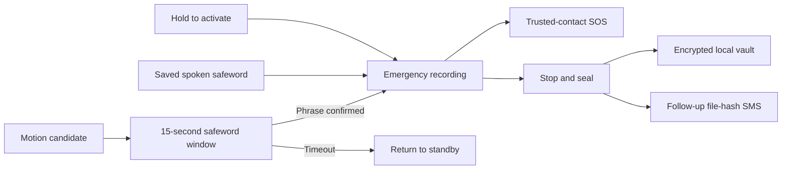

<div align="center">


# VAANI

### A voice for safety. Evidence that stays with you.

A privacy-first Android safety prototype combining safeword activation,<br />
encrypted evidence, trusted-contact alerts, and opt-in nearby connections.


[Explore the features](#built-around-five-spaces) · [Run locally](#run-locally) · [Test the app](#build-and-validation) · [Documentation](#documentation)

</div>

---

## Safety, with control in your hands

VAANI brings emergency activation, private evidence capture, and practical safety tools into one app. Activate it with a deliberate hold or your saved spoken phrase, record an incident, and seal the evidence into an encrypted local vault. Configured trusted contacts can receive an SMS with your available location, followed by the sealed recording's file fingerprint.

Everyday tools sit alongside the emergency flow: a Notes disguise, a private camera, a decoy call, multilingual controls, and Bluetooth nearby profiles with explicit sharing choices.

> **Project status:** This is a working Android prototype. Automated build and unit checks pass; real Google sign-in, two-phone Bluetooth interoperability, and device-level acceptance testing remain unconfirmed. See [validation details](docs/GOOGLE-LOGIN-INTEGRATION-VALIDATION.md).

## Built around five spaces

| Space | What you can do |
| :--- | :--- |
| **Vaani** | Hold to activate emergency recording, manage your safeword, monitor the listening state, capture media, schedule a decoy call, and open blackout or Notes. |
| **Vault** | Authenticate to view sealed evidence, play audio, preview photos and videos, verify the hash chain, export a custody record, and delete evidence with a retained hash-only record. |
| **Community** | Explore the map and sample route overlays, refresh your location, try local demo reports, or explicitly start Bluetooth nearby-profile exchange. |
| **Support** | Open public support resources, nearby station and hospital searches, and dialer shortcuts. |
| **Settings** | Choose interface and speech languages, connect a Google profile, manage trusted contacts, configure protection, and replay the guided walkthrough. |

## From activation to sealed evidence



SMS requires configured contacts, permission, a default SMS SIM, and cellular service. Available location is included in the initial message. After successful audio sealing, the original recipients who remain trusted can receive the same incident ID and the encrypted file's full SHA-256 hash. Failed or unfinished recordings do not produce that hash message.

## Features that matter

### Deliberate activation and voice control

- **Hold-to-activate control** for manual emergency capture.
- **Saved safeword recognition** through Android's speech service, with independent controls for continuous listening and motion confirmation.
- **15-second motion confirmation:** accelerometer and gyroscope rules detect a possible drop or snatch and open a listening window. Motion alone does not activate an emergency.
- **On-device audio analysis** using the bundled YAMNet TensorFlow Lite model. Threat scores are prototype estimates, not validated assessments of danger.

Voice and motion monitoring work while the app is open in the foreground. Offline recognition depends on the phone's speech-service support and installed models; a dedicated offline wake-word engine is not included.

### Evidence you control

- **AES-256-GCM encryption** with keys held by Android Keystore; hardware backing depends on the device.
- **SHA-256 hash chaining** and an in-app integrity check for sealed evidence.
- **Device authentication** before accessing the vault, with locking when the app leaves the foreground.
- **Audio, photos, and silent video**, including video capture up to 60 seconds and image/video import.
- **Incident grouping, media previews, and JSON chain-of-custody export.**
- **Deletion with a hash-only record** so later chain entries can still be verified.

Evidence stays on the device. The SMS file fingerprint and the vault's chain hash serve different purposes; neither is a decryption key. A hash chain helps detect changes—it does not by itself establish the truth or legal admissibility of a recording.

### Discreet everyday tools

**Notes disguise** offers a working memo, grocery checklist, categories, and search. Enable the Notes launcher identity or quickly hide the safety interface. Return using your saved phrase in Notes search, an existing fallback code (`##`, `vaani`, or `911`), or a two-second hold on the PERSONAL header. Typed Notes unlock opens the interface without triggering an emergency.

**Decoy call** provides a local incoming-call simulation immediately or after 15/30 seconds. **Blackout display** hides the interface until a double-tap. These are local interface tools; the decoy does not place a call.

### Multilingual by design

| Interface | Speech-language choices |
| :--- | :--- |
| English · हिन्दी · मराठी | English, Hindi, Marathi, Bengali, Tamil, Telugu, Gujarati, Kannada, Spanish, French |

Interface translations are bundled and work without translation downloads. Interface and speech preferences are separate: changing either language preserves the saved safeword until you explicitly replace it. Speech-language availability depends on the device.

### Google profile and nearby connections

Google sign-in is optional during setup and available later in Settings. It imports the chosen name and email into the local Community profile. You can continue without an account.

In **Community → Real-time mesh**, two phones can explicitly start direct Bluetooth Low Energy discovery and exchange public profiles. Phone, email, and approximate location each require a separate sharing choice. Account import resets sharing choices; sign-out clears the linked local profile. Leaving the pane or backgrounding the app stops the session.

Google credentials and ID tokens are not stored in the mesh profile or broadcast over BLE. Local Google sign-in does not authenticate a nearby peer, create a backend session, or sync evidence to the cloud. The Bluetooth implementation provides direct profile exchange; multi-hop routing and SOS relay are not implemented.

## A short demo

1. Open the app, connect a Google profile or continue without one, and explore the walkthrough.
2. In **Settings**, choose your interface language and review the saved safeword and voice support.
3. Try **Test interface quietly**, Notes disguise, the map, and the decoy call.
4. With informed test contacts configured—or no contacts for a capture-only demonstration—hold the activation control and record a short sample.
5. Select **Stop & Seal Evidence**, authenticate in **Vault**, play the sample, and run **Verify chain integrity**.
6. With a second phone, start nearby discovery on both and test each sharing choice separately.

> Emergency activation can send real SMS. Use agreed test contacts. Check support dialer shortcuts without placing test calls to emergency services.

## Run locally

### Requirements

- Android Studio and **JDK 17 or newer**; this checkout was validated with JDK 21.
- Android SDK Platform **35**, with SDK location configured through Android Studio or `local.properties`.
- An Android **8.0 / API 26+** device or emulator. Use physical phones for sensors, carrier SMS, biometrics, and Bluetooth acceptance testing.

Clone and open the repository root in Android Studio:

```bash
git clone https://github.com/arsh-bhagat/VAANI-CODE-APEX-3.0.git
cd VAANI-CODE-APEX-3.0
```

The Gradle project is named `SHELTER`; the app package is `com.bithead.shelter`. Let Gradle sync and select the `app` run configuration.

### Local debug signing

The build expects `app/vaani-debug.keystore`, which is intentionally excluded from Git. Keep an existing development key so installed updates and OAuth registration remain consistent. For a fresh checkout without that file, create a local debug key:

```bash
keytool -genkeypair -keystore app/vaani-debug.keystore -alias androiddebugkey -keyalg RSA -keysize 2048 -validity 10000 -storepass android -keypass android -dname "CN=Android Debug,O=Android,C=US"
```

These are development-only signing credentials. Register your own signing certificate for Google login; a newly generated key will have a different fingerprint.

### Google sign-in configuration

Configure a Web OAuth client in `app/src/main/res/values/account.xml` under `google_web_client_id`, and an Android OAuth client in the same Google Cloud project for the package and installed APK's signing SHA-1. Configure consent/test users as appropriate. Do not put a client secret in the app.

The checked-in client ID belongs to the supplied project configuration and does not configure a new developer's environment automatically. See the [Google account setup and behavior](docs/google-account-login.md).

### Build

On Windows PowerShell:

```powershell
.\gradlew.bat :app:assembleDebug
```

On macOS or Linux:

```bash
./gradlew :app:assembleDebug
```

The APK is generated at `app/build/outputs/apk/debug/app-debug.apk`.

The build also checks an optional sibling `../offline-m2` repository for locally mirrored dependencies, then uses Google and Maven Central. The local SDK, signing keys, APKs, and private motion datasets are excluded from version control.

## Build and validation

```powershell
.\gradlew.bat :app:testDebugUnitTest :app:assembleDebugAndroidTest :app:lintDebug
python scripts/localization/check_copy.py
python scripts/check-walkthrough.py
node scripts/check-map.cjs
```

Use `./gradlew` in place of `.\gradlew.bat` on macOS/Linux. The static checks require Python 3 and Node.js.

**Latest recorded local validation · 31 October 2026**

| Check | Result |
| :--- | :--- |
| Debug app assembly | Passed |
| JVM unit tests | **54 passed**, no failures or skips |
| Device-test APK assembly | Passed; tests not executed on a device |
| Android lint | **0 errors**, 58 warnings; two documented test-only false-positive suppressions |
| Bundled localization | 495 UI entries; 111 walkthrough/mesh/account resources per locale |
| Walkthrough wiring and map checks | Passed |
| Debug APK signature | Verified against the retained local key |

These results describe the recorded local run, not a live CI status. Real Google sign-in and two-phone BLE testing remain outstanding. See the [full validation record](docs/GOOGLE-LOGIN-INTEGRATION-VALIDATION.md) and [phone testing guide](ANDROID_PHONE_TESTING.md).

## Design direction

A dark palette, warm gold accents, direct controls, and a discreet Notes persona inform the interface. The images below are **design references**, not verified screenshots of the current APK.

<table>
  <tr>
    <td align="center" width="33%"><br /><sub>Safety dashboard</sub></td>
    <td align="center" width="33%"><br /><sub>Evidence vault</sub></td>
    <td align="center" width="33%"><br /><sub>Notes disguise</sub></td>
  </tr>
</table>

## Project map

```text
app/src/main/
├── java/com/bithead/shelter/
│   ├── ai/             Speech preferences, phrase matching, audio and motion models
│   ├── data/           Room storage and local preferences
│   ├── emergency/      Trusted-contact SMS and location protection
│   ├── mesh/           BLE transport, public profiles, and consent filtering
│   ├── security/       Evidence cryptography
│   ├── sensors/        IMU sampling and motion confirmation
│   └── ui/             Compose screens, localization, and guided walkthrough
├── assets/             YAMNet model, Leaflet, and bundled map/UI resources
└── res/                Android resources and Hindi/Marathi translations
scripts/                Localization checks and motion-data tooling
docs/                   Implementation notes and validation records
```

The app uses **Kotlin, Jetpack Compose, Material 3, CameraX, Room, Android Keystore, Credential Manager, TensorFlow Lite, and Leaflet**.

## Prototype boundaries

| Area | Current scope |
| :--- | :--- |
| Recognition and motion | Foreground operation; no always-on background monitoring or guaranteed offline wake-word detection. Motion rules and audio scores need physical-device validation. |
| Community map | Real map tiles with sample routes, risk areas, and observations. Demo reports stay local to the session; no live safety scoring. |
| Emergency response | Configured trusted-contact SMS. Police, NGO, peer, and shelter dispatch integrations are previews. |
| Nearby profiles | Direct, opt-in BLE exchange. No authenticated peer identities, end-to-end encryption, or multi-hop relay. |
| Evidence and accounts | Local vault and optional Google profile import. No cloud backup, cross-device account sync, or server-side token verification. |

## Documentation

| Guide | Contents |
| :--- | :--- |
| [Phone testing](ANDROID_PHONE_TESTING.md) | Install, permissions, capture checks, and device testing |
| [Integration validation](docs/GOOGLE-LOGIN-INTEGRATION-VALIDATION.md) | Build results, test coverage, and remaining acceptance checks |
| [Google account integration](docs/google-account-login.md) | OAuth configuration, local profile behavior, and sign-out |
| [Bluetooth nearby profiles](docs/realtime-mesh.md) | Protocol, sharing consent, and two-phone test plan |
| [Multilingual implementation](docs/MULTILINGUAL_IMPLEMENTATION.md) | Bundled interface copy and speech-language behavior |
| [Motion confirmation](docs/MOTION_CLASSIFIER_IMPLEMENTATION.md) | Sensor rules, confirmation windows, and optional model tooling |
| [Motion data audit](docs/LOOSE_PHONE_DROP_DATA_AUDIT.md) | Dataset suitability and loose-phone model requirements |
| [Walkthrough design](docs/WALKTHROUGH_UIUX.md) | Onboarding, feature anchors, and layout behavior |

---

<div align="center">
<sub>Built to explore how personal safety tools can preserve privacy, choice, and useful evidence.</sub>
</div>
